# Descobertas e conclusões a partir da Análise Exploratória de Dados

Pergunta central: **Os descontos influenciam na lucratividade da empresa?**

## 1. Produtos com alto faturamento e baixa lucratividade
-   'Cisco TelePresence System EX90 Videoconferencing Unit' foi o 3º produto de maior faturamento ($22,638.48), porém gerou prejuízo (-$1,811.08).
-   'HON 5400 Series Task Chairs for Big and Tall' foi o 4º produto de maior faturamento ($21,870.57), porém sem lucro nenhum ($0.00).

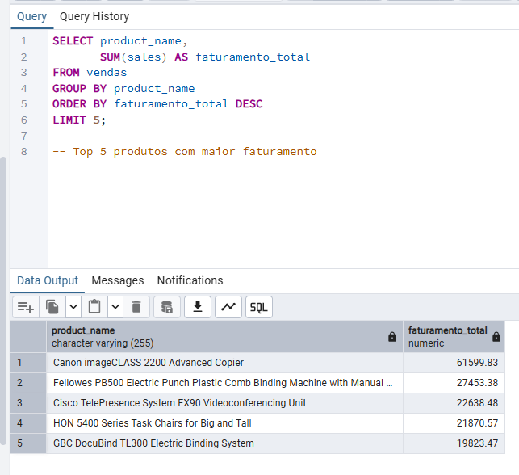

**'Cisco TelePresence System EX90 Videoconferencing Unit'**:
-   O produto teve somente 1 venda, em quantidade (6), com desconto de 50%, o que possivelmente causou esse prejuízo.

**'HON 5400 Series Task Chairs for Big and Tall'**:
-   O produto teve 8 vendas, vendas com 20% de desconto não geraram lucro e, vendas com 30% de desconto geraram prejuízo.
-   A empresa teve lucro com esse produto somente em vendas com desconto abaixo de 20%.
-   **Recomendação**: visando lucro com as vendas desse produto, não aplicar descontos acima de 20%.

## 2. Produtos com menor lucro
-   'Cubify CubeX 3D Printer Double Head Print' (-$8,879.97), 'Lexmark MX611dhe Monochrome Laser Printer' (-$4,589.97) e 'Cubify CubeX 3D Printer Triple Head Print' (-$3,839.99) foram os 3 produtos de menor lucro.

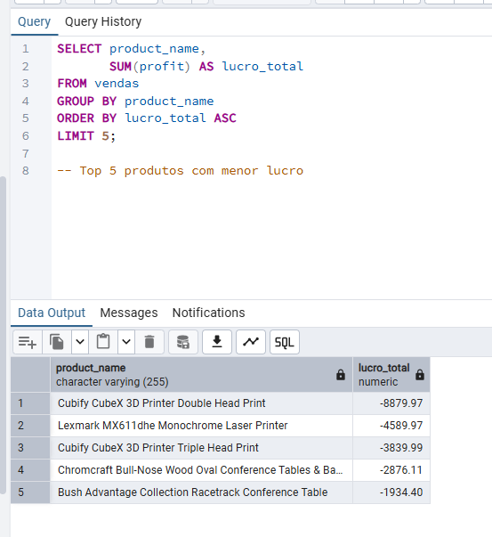

Analisando as vendas dos 3 produtos:

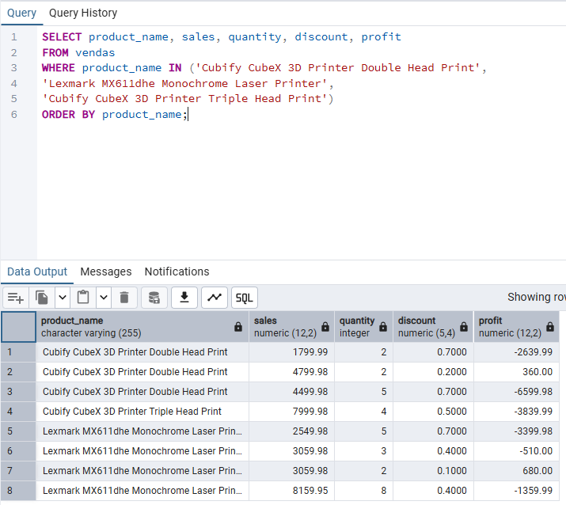

**'Cubify CubeX 3D Printer Double Head Print'**:
-   2 vendas com descontos altíssimos (70%) geraram prejuízo de -$9,239.97.
-   Somente 1 venda gerou lucro, venda essa que teve 20% de desconto (baixo).

**'Lexmark MX611dhe Monochrome Laser Printer'**:
-   2 vendas com descontos altíssimos (70%), 1 venda com desconto relativamente alto (40%) e 1 venda com desconto baixo (10%).
-   Somente a venda com desconto baixo (10%) gerou lucro, as outras 3 vendas geraram prejuízo de -$5,269.97.

**'Cubify CubeX 3D Printer Triple Head Print'**:
-   O produto teve somente 1 venda, em quantidade (5), porém com desconto de 50%, possivelmente justificando o prejuízo.

Hipótese: a alta aplicação de descontos na venda de produtos está resultando em grande prejuízo. Para confirmar essa hipótese, vamos identificar as vendas do top 3 produtos com maior lucro.

## 3. Produtos com maior lucro
-   'Canon imageCLASS 2200 Advanced Copier' ($25,199.94), 'Fellowes PB500 Electric Punch Plastic...' ($7,753.04) e 'Hewlett Packard LaserJet 3310 Copier' ($6,983.89) foram os 3 produtos de maior lucro.

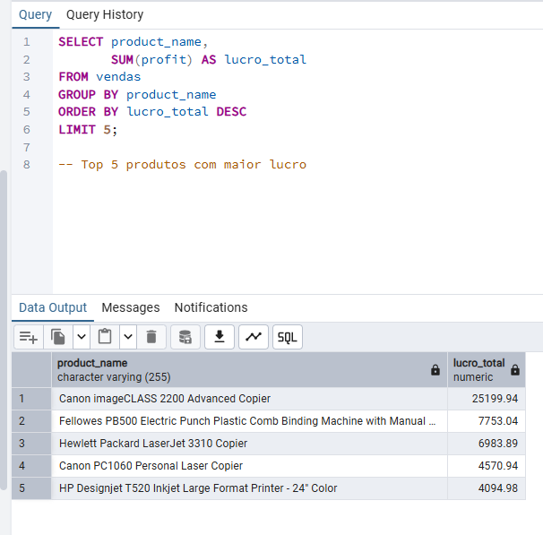

**'Canon imageCLASS 2200 Advanced Copier'**:

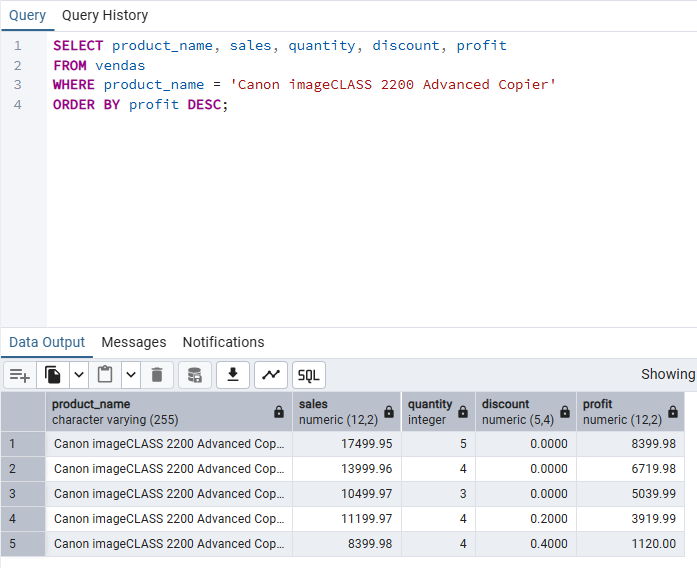

-   As 3 vendas que geraram maior lucro do produto mais lucrativo para a empresa não tiveram descontos.
-   As outras 2 vendas do produto tiveram descontos (20% e 40%) e, coincidentemente, o lucro foi menor.

**'Fellowes PB500 Electric Punch Plastic...'**:

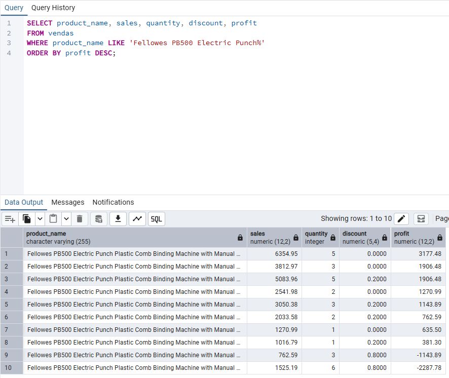

-   4 vendas sem desconto e 4 vendas com desconto baixo (20%), ambas geraram lucro para a empresa.
-   As outras 2 vendas com descontos extremamente altos (80%) geraram prejuízo.

**'Hewlett Packard LaserJet 3310 Copier'**:

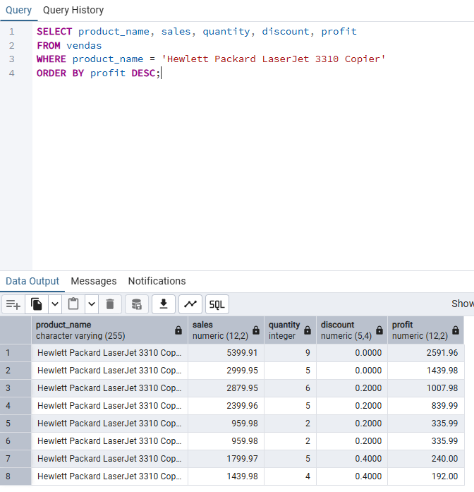

-   Nas vendas deste produto fica nítido que o lucro diminui conforme o desconto aumenta.

## 4. Aplicação de desconto

Antes de concluírmos nossa hipótese, vamos identificar a quantidade de descontos aplicados em itens vendidos:

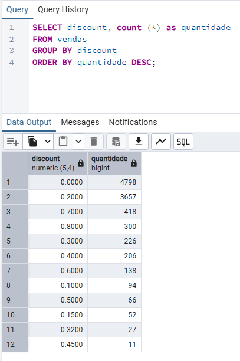

-   Dos 9993 registros de itens vendidos, 5195 tiveram descontos, **mais da metade** (52%)
-   1139 registros de itens vendidos tiveram descontos relativamente alto/alto (40%+)
-   Destaque para a alta frequência de descontos extremamente altos (70% e 80%), que ocupam a 3º e 4º posições entre os mais aplicados nas vendas (comportamento incomum que, possívelmente está impactando negativamente no lucro da empresa).

Agora, a quantidade de itens com desconto em cada venda:

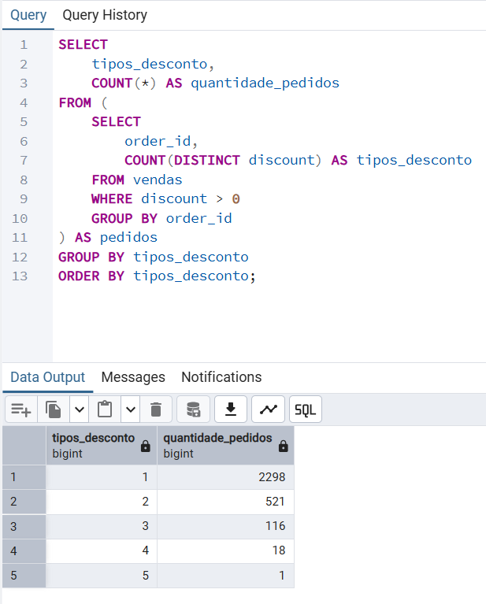

-   2298 vendas tiveram 1 item com desconto, 521 vendas tiveram 2 itens com desconto, 116 vendas tiveram 3 itens com desconto, 18 vendas tiveram 4 itens com desconto e 1 venda teve 5 itens com desconto.
-   Das 5009 vendas, 2954 tiveram pelo menos um produto com desconto, **mais da metade** (58,97%)

## 5. Lucro médio e lucro total de itens vendidos com descontos

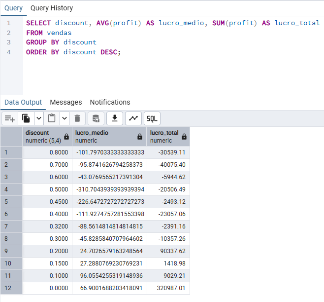

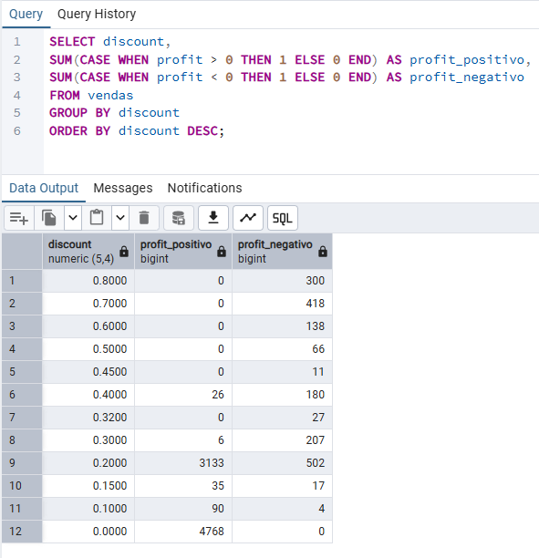

-   Itens vendidos com 30%+ de desconto parecem gerar prejuízo para a empresa.
-   Itens vendidos com 40%+ de desconto geraram **-$122,615.80** de prejuízo para a empresa.
-   Dos **1379** registros de itens vendidos com 30%+ de desconto, somente **32 geraram lucro** para a empresa.
-   **Nenhum registro de item vendido** com 45%+ de desconto gerou lucro para a empresa.

A partir dessa análise, é possível concluir que a empresa não está tendo lucro em itens vendidos com desconto igual ou acima de 40%, e, a empresa também teve muitos itens vendidos com descontos extremamente altos (70% e 80%), que, de fato, impactaram negativamente no lucro da empresa.

**Recomendações (visando lucro):**
-   Evitar ao máximo aplicar descontos de 50% ou mais, somente em ocasiões específicas/datas comemorativas e em produtos que, mesmo com esse desconto, gerariam lucro para a empresa.
-   Como mais da metade dos registros de vendas tiveram desconto (58,97%) e, de acordo com o dataset, a maioria dos itens são vendidos em quantidade, averiguar com o setor financeiro a possibilidade de um programa de fidelidade para atrair novos clientes e aumentar o lucro da empresa, por exemplo: a cada 3 itens comprados, 20% de desconto aplicado na compra do **próximo item** (desconto baixo). Dessa forma o desconto seria aplicado somente em 1 item após a compra de 3 itens sem desconto.

*(Insights feitos antes da criação do dashboard)*