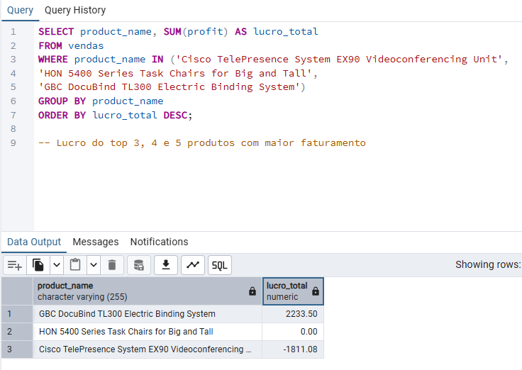
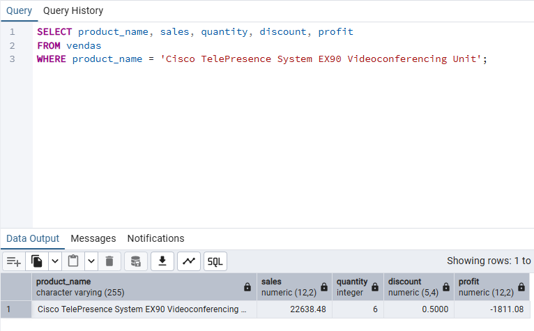
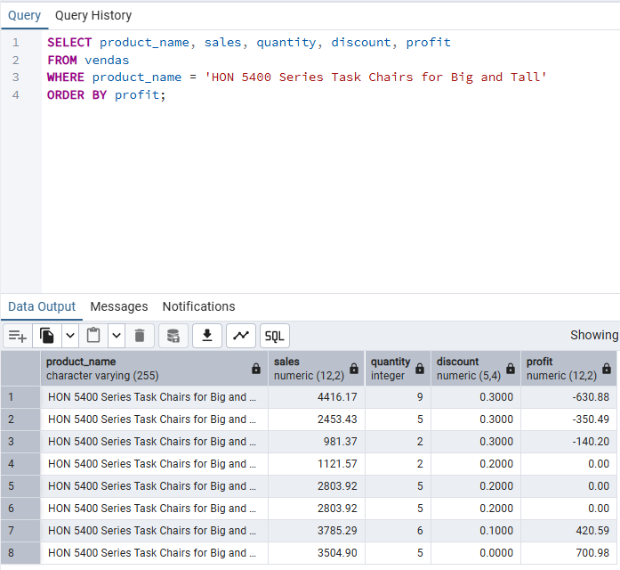

# Descobertas e conclusões a partir da Análise Exploratória de Dados

## 1. Produtos 'HON 5400 Series Task Chairs for Big and Tall' e 'Cisco TelePresence System EX90 Videoconferencing Unit'
-   'Cisco TelePresence System EX90 Videoconferencing Unit' foi o 3º produto de maior faturamento ($22,638.48), porém gerou prejuízo (-$1,811.08).
-   'HON 5400 Series Task Chairs for Big and Tall' foi o 4º produto de maior faturamento ($21,870.57), porém sem lucro nenhum ($0.00).

**'Cisco TelePresence System EX90 Videoconferencing Unit'**:
-   O produto teve somente 1 venda, em quantidade (6), com desconto de 50%, o que possivelmente causou esse prejuízo.

**'HON 5400 Series Task Chairs for Big and Tall'**:
-   O produto teve 8 vendas, vendas com 20% de desconto não geraram lucro e, vendas com 30% de desconto geraram prejuízo.
-   A empresa teve lucro com esse produto somente em vendas com desconto abaixo de 20%.
-   **Recomendação**: visando lucro com as vendas desse produto, não aplicar descontos acima de 20%.

## 2.