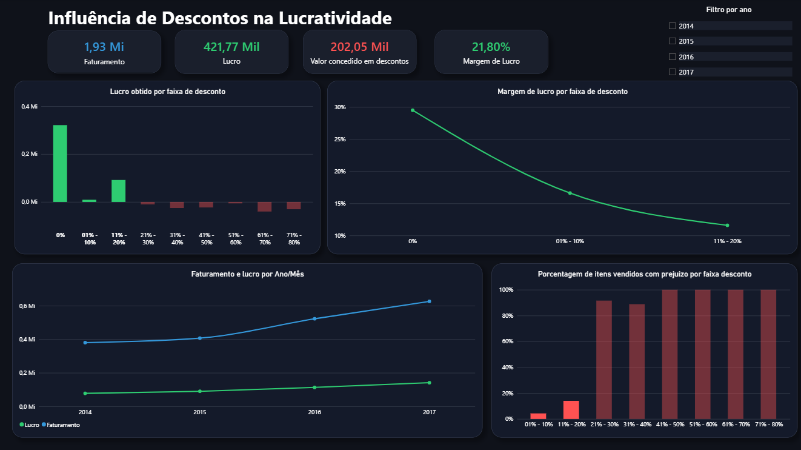
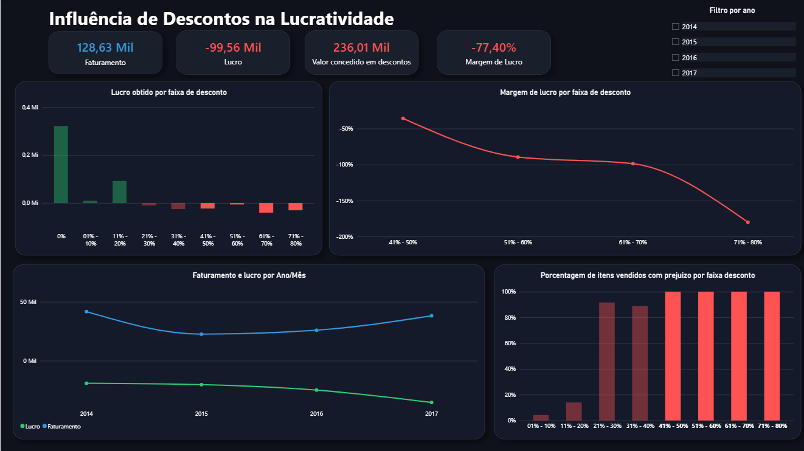

# Análise do Dashboard (sem filtro de ano)

### Descontos de até 20%
-   A empresa tem uma margem de lucro muito boa na venda de itens sem desconto e descontos de até 20%.
-   A venda de itens sem desconto gerou aproximadamente 321 mil dólares de lucro para a empresa, com margem de lucro de **29,50%** nas vendas.
-   Dos 2.3 Mi faturados pela empresa, aproximadamente 1.93 Mi foram da venda de itens sem desconto e com desconto de até 20% (**84% do faturamento total da empresa**), gerando **lucro de 421 mil dólares**.

### Descontos superiores a 20%
-   Descontos acima de 20% fazem a margem de lucro cair drasticamente, chegando a números negativos.
-   Essa afirmação fica nítida no gráfico "Lucro obtido por faixa de desconto", itens vendidos com 20%+ de desconto não foram lucrativos para a empresa, principalmente ao analisar o gráfico "Porcentagem de itens vendidos com prejuízo por faixa de desconto": **91,59%** dos itens vendidos com 20%+ de desconto geraram prejuízo para a empresa.
-   **Todos** os itens vendidos com 40%+ de desconto geraram prejuízo para a empresa, totalizando aproximadamente 236 mil dólares concedidos em descontos e resultando em uma margem de lucro de -77,40%.
-   236 mil dólares concedidos em descontos são **mais de 80% do lucro total da empresa**(286 mil dólares).
-   Nota-se que, foram poucas vendas de itens com descontos altos, mas foram essas poucas vendas que afetaram o lucro da empresa.
-   Questionamento: Qual o sentido dessas vendas? Poucos itens, porém prejuízo enorme.

*(imagem dos itens vendidos com 40%+ de desconto)*

## Conclusão
Diante do dashboard analisado: 
-   Sim, os descontos influenciam na lucratividade da empresa.
-   **Concentração de Resultado:** A venda de itens com até 20% de desconto foi responsável por **84% do faturamento total** da empresa, gerando **421 mil dólares de lucro**. Porque não seguir com essa política de vendas?
-   **Destruição de Valor:** Itens vendidos com 20%+ de desconto não fazem sentido para a empresa, pois **mais de 90% causaram prejuízo** e diminuíram muito o lucro total.
-   Sugestão (visando lucro): aplicar 20%+ de desconto somente em itens que, mesmo com esse desconto, gerem lucro. Caso contrário, descontinuar esses descontos e manter a política de vendas de até 20% de desconto, já que foram responsáveis por 95% do faturamento total da empresa e geraram 421 mil dólares de lucro.

*(Insights feitos depois da criação do dashboard)*